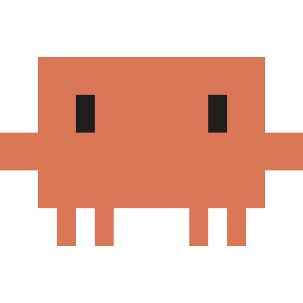

# Claude Buddy

A little pixel-art buddy (Claude's character) that floats on your Windows desktop. Click it, ask anything, and it
answers **about what's on your screen** (code, errors, web pages, documents, settings, anything), **writes Word and
PDF documents** for you, and can **click and type on your PC** when you ask, using a free AI model that runs **on
your own PC** through [Ollama](https://ollama.com). No account, no API key, no cost per question.



- **Floating buddy**: always on top, drag it anywhere. Its eyes follow your mouse, it waves when you hover,
  shows a spinner while it thinks, and falls asleep when you're away.
- **Sees your screen**: every message you send includes a fresh screenshot. The buddy and the chat window hide
  themselves from it, so the model sees exactly what you see.
- **Writes documents**: "make a Word summary of this page" saves a real `.docx` (or PDF, Markdown, text, web
  page) in `Documents\Claude Buddy`, with Open and Show-in-folder buttons in the chat. Arabic is laid out right to left.
- **Works your PC**: "fill in this form", "open Notepad and write…": it clicks, types, presses keys, scrolls and
  opens apps or web pages, checking a new screenshot after every step. By default it **asks before every action**.
- **Your choice of model**: anyone using the app can download any model from the Ollama library inside the app,
  switch between models, and delete the ones they don't need.
- Streams answers with formatting, code blocks with Copy buttons, and a "thinking" view for models that reason.
- Global shortcut, tray icon, light/dark theme, Arabic and other right-to-left languages supported.

## Get started

1. **Install Ollama** (free) from [ollama.com/download](https://ollama.com/download). Already have it? Skip this.
2. **Start the app**: double-click `dist\Claude Buddy-win32-x64\Claude Buddy.exe`, or use the *Claude Buddy*
   shortcut on the desktop or in the Start menu. (From source: `npm install`, then `npm start`.)
3. **Click the buddy** in the bottom-right corner. The chat walks you through the rest:
   - *Ollama isn't running* → click **Start Ollama**.
   - **Models you already have are used right away** (ones that can see the screen are preferred).
   - **No model at all?** Buddy starts downloading `qwen3.5:4b` by itself (about 3.3 GB, one time), with a progress
     bar. Click **Cancel** if you'd rather pick another model; it then won't download on its own again.
   - Only text-only models (like `llama3.2`)? They work for chatting, and a card offers to download `qwen3.5:4b` so
     Buddy can see your screen too.

That's it. Ask things like *"What's this error and how do I fix it?"*, *"Summarize this page"*,
or *"Help me reply to this email"*. The first answer after starting can take up to a minute while the model loads
into memory; after that, answers come in seconds.

## Adding your own model

Open **Settings** (the gear) → **Add a model**:

- Click **Download** next to a suggested model, or
- type any model name from the [Ollama library](https://ollama.com/search?c=vision) (for example `gemma3:4b`,
  `qwen3.5:9b`, or `hf.co/user/repo` for a model on Hugging Face) and click **Download**. Pasting
  `ollama run gemma3:4b` or an ollama.com link works too.

Models you already pulled with Ollama on the command line show up automatically. Pick one under **Model** (or from
the menu next to *Buddy* in the title bar). The trash icon deletes a model from your PC.

**Only models that can see images can read your screen.** They're marked *Sees screen*. Text-only models (like
`llama3.2`) still chat, but the composer shows *Can't see screen* and no screenshot is taken.

| Suggested model | Download | Good for |
| --- | --- | --- |
| `qwen3.5:4b` (default) | ~3.3 GB | Most laptops |
| `qwen3.5:2b` | ~2.7 GB | Older or low-memory PCs |
| `gemma3:4b` | ~3.4 GB | Most laptops |
| `qwen3.5:9b` | ~6.6 GB | PCs with a strong graphics card (8 GB+) |
| `gemma4:e4b` | ~6.6 GB | PCs with a strong graphics card (8 GB+) |

## Documents

Ask for a document in your own words: *"Write a short Word report about this slide"*, *"Make me a PDF study plan for
next week"*, *"اكتب لي مستند وورد عن…"*. Buddy writes it and saves it in **Documents\Claude Buddy** as Word (`.docx`,
the default), PDF, Markdown, text or a web page, then shows a card with **Open** and **Show in folder**. Files are
never overwritten: a second "Report" becomes "Report (2)". Turn this off in Settings → *Create documents*.

## Letting Buddy use your PC

Settings → **Control my PC**:

| Setting | What happens |
| --- | --- |
| **Ask first** (default) | Each action shows a card with what Buddy wants to do and, for clicks, a close-up of the screen with a red circle where it will click. Choose **Allow**, **Allow all** (for the rest of this request) or **Don't**. |
| **Allow** | Buddy acts on its own. **Move the mouse** and it stops right away. |
| **Off** | Buddy only looks and answers. |

- Press **■** in the chat at any time to stop.
- Buddy works on the screen the chat is on, and needs *Screen on* to act.
- It stops by itself after 15 actions, or when it repeats the same action without anything changing on the screen.
- It never types passwords or payment details, and it's told to ignore instructions written on web pages or in
  documents. Only you give it tasks.
- Windows doesn't let normal apps control apps that run as administrator (Task Manager, some installers), so Buddy
  can't use those.
- Local models are small and do make mistakes, such as clicking the wrong spot or saying something is done when it
  isn't. Keep an eye on what it does, and keep *Ask first* for anything important.

## Using it

| Action | How |
| --- | --- |
| Open / close the chat | Click the buddy, or press the shortcut shown on the welcome screen (e.g. `Alt+Shift+Space`) |
| Move the buddy | Drag it |
| Menu (settings, hide, start with Windows, quit) | Right-click the buddy or the tray icon |
| Don't send my screen this time | Click **Screen on** in the message box to switch it off |
| See what the model saw | Click the screenshot thumbnail above your message |
| Stop an answer | Click the ■ button while it's replying |
| New chat | ✎ button or `Ctrl+N` |
| Hide the chat | `Esc` or × |

When an answer arrives while the chat is closed, the buddy shows a little speech bubble.

## Privacy

- Your screen is captured **only when you send a message** (and only if *Screen on* is lit), from the display
  the chat is on. Nothing is recorded in the background.
- Screenshots go only to Ollama on your PC and are never saved to disk. Only the newest screenshot is sent with
  each message.
- Exceptions you choose yourself: Ollama *cloud* models (names ending in `cloud`, marked *Cloud*) run on
  ollama.com, and a custom *Ollama address* sends everything to that computer. Settings tells you when that's the case.
- The model is told that text inside screenshots is content to read, not instructions to follow.

## Settings

- **Ollama**: whether it's running, with a button to start it. *Ollama address* is for running Ollama on another
  computer (default `http://127.0.0.1:11434`).
- **Model** / **Add a model**: see above.
- **Thinking** (only for models that can reason, e.g. qwen3.5): *On* is smarter on tricky questions but slower.
- **Control my PC**: Off / Ask first / Allow (see above). **Create documents**: on or off. Both need a model that can
  use tools (qwen3.5 can); clicking and typing also need one that can see the screen.
- **Screenshot detail**: *Sharp* (1920 px) reads small text best; *Light* (1280 px) is faster.
- **Shortcut**: click the box and press a combination. On first run the app picks the first free one of
  `Ctrl+Alt+Space`, `Alt+Shift+Space`, `Ctrl+Alt+B`, `Ctrl+Shift+Alt+Space`.
- **Show the floating buddy** / **Start with Windows**.

## Build the .exe yourself

```bash
npm install
npm run package
```

The app is written to `dist\Claude Buddy-win32-x64\`. Copy that whole folder anywhere you like.
`npm run icons` regenerates `assets\icon.ico` from the pixel art.

## How it works

```
src/
  main/main.js        windows, tray, shortcut, dragging, Ollama status, downloads, carrying out actions, IPC
  main/ollama.js      Ollama API: models, downloads, the chat and action loop, conversation history, errors
  main/tools.js       the actions the model can call, and checks on what it sends
  main/input.js       real mouse and keyboard input (a hidden PowerShell helper calling Windows' SendInput)
  main/documents.js   Word / PDF / Markdown / text / web page files from the model's Markdown
  main/capture.js     screenshots, sized for vision models (1920 / 1280 px)
  main/settings.js    settings file
  preload.js          the small, safe bridge between the windows and the main process
  renderer/mascot.*   the floating character (canvas animation)
  renderer/chat.*     the chat window and settings page
  shared/sprite.js    the pixel-art character, shared by everything (and the icon builder)
```

- Built with Electron. It talks to Ollama's local HTTP API (`/api/chat`, `/api/pull`, `/api/tags`, …) directly,
  with no extra libraries.
- Requests ask for a 16K-token context (a screenshot alone is about 2.3K tokens, and tasks take several steps) and
  keep the model loaded for 10 minutes. Opening the chat preloads the model so the first answer comes sooner.
- Actions use Ollama's tool calling. The model points at things on a 0–1000 grid over the screenshot (that's how
  Qwen vision models are trained), and Buddy converts that to real screen pixels. Its own windows let clicks pass
  through while it works.
- The buddy's windows use Windows' "exclude from capture" flag (Windows 10 version 2004 or newer), which is why
  they never appear in screenshots. On older Windows they hide for a moment instead.
- The character is a fan-made pixel version of Claude's mascot. The answers come from whichever Ollama model you
  pick, not from Anthropic.

## Troubleshooting

- **"Ollama isn't running"**: click *Start Ollama*, or open Ollama from the Start menu. (Starting it may also open
  Ollama's own window; you can close that window, and Ollama keeps running in the tray.)
- **"There isn't enough memory to run …"**: close some apps, or pick a smaller model (e.g. `qwen3.5:2b`).
- **A download says "Waiting for the network…" or failed**: your connection dropped. Ollama keeps what it already
  downloaded, so *Try again* continues from there instead of starting over.
- **The first answer is slow**: the model is loading into memory. Later answers are much faster.
- **"Can't see screen"**: the selected model is text-only. Pick or download one marked *Sees screen*.
- **Buddy clicks the wrong spot or loops**: keep *Ask first* on and press **Don't** on wrong actions, or try a bigger
  model (e.g. `qwen3.5:9b`) if your graphics card can run it.
- **Typing does nothing in an app**: that app may run as administrator, which Windows protects from other apps.
- **The shortcut does nothing**: another app owns it. Pick a different one in Settings.
- **The buddy disappeared**: right-click the tray icon (near the clock) → *Show floating buddy*.
- **Quit completely**: right-click the buddy or the tray icon → *Quit Claude Buddy*.
